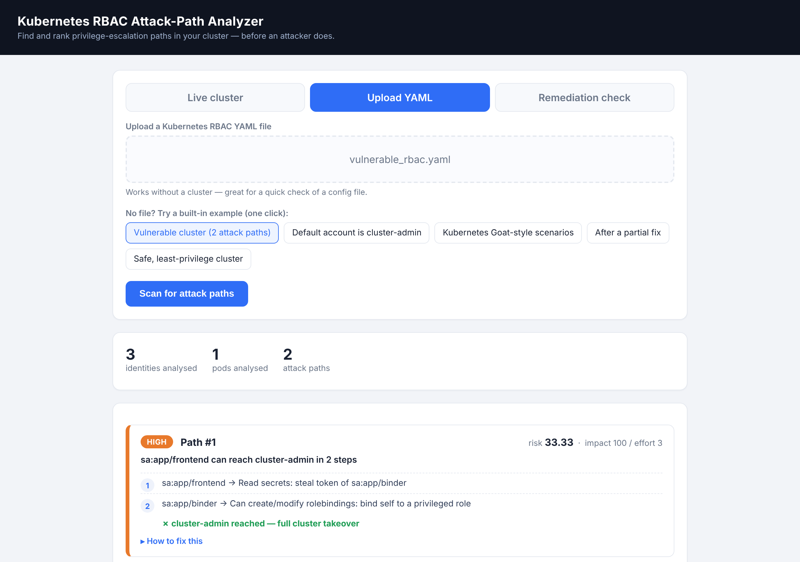

# Kubernetes RBAC Attack-Path Analyser

A defensive security tool that reads Kubernetes RBAC, discovers the multi-step
paths an attacker could take from a low-privilege ServiceAccount up to
cluster-admin, ranks those paths by risk, explains how to fix each one, and
verifies that a fix actually removed the path.

It works on static YAML manifests or a live cluster, and runs entirely on the
local machine — cluster credentials never leave it.

> MSc project · Python (NetworkX, Flask, Kubernetes client) · 45 automated tests

[](https://codespaces.new/sidc2122/k8s-rbac-attackgraph)



## Try it in 2 minutes (no Kubernetes cluster needed)

```bash
git clone https://github.com/sidc2122/k8s-rbac-attackgraph.git
cd k8s-rbac-attackgraph
python -m pip install -r requirements.txt
python -m rbacgraph.web
```

Open http://127.0.0.1:5000, choose **Upload YAML**, pick
`samples/vulnerable_rbac.yaml` and click **Scan for attack paths**.

Prefer the terminal? `python -m rbacgraph.cli analyze samples/vulnerable_rbac.yaml`

## The problem

Kubernetes RBAC permissions are dangerous in combination, not in isolation. A
ServiceAccount that can read Secrets, and another that can create RoleBindings,
each look reasonable on their own. Together they form a route: an attacker who
compromises the first account reads a Secret to steal the second account's
token, then uses that token to bind itself to cluster-admin.

Most open-source scanners report these as separate, individually-scored
findings. They flag "this account can read secrets" and "that role can create
bindings" as unrelated items, leaving the operator to work out that together
they form a route to full cluster takeover — and which one to fix first. This
tool connects those findings into ranked, multi-step attack paths, gives the
exact fix for each, and confirms the fix worked.

## Features

- Reads RBAC from static YAML or a live cluster (read-only, credentials stay local).
- Chains permissions into attacker-traversable paths to cluster-admin, using
  twelve escalation primitives grounded in the Kubernetes RBAC documentation,
  OWASP K03 and Palo Alto Networks' rbac-police rule set.
- Ranks paths by attacker effort versus privilege impact (`Risk = Impact / Effort`),
  so the cheapest route to takeover surfaces first.
- Explains each risky step in plain language and generates the exact `kubectl`
  fix, scoped to the actual binding in the scanned cluster.
- Prefers least-privilege scoping over deletion, so remediation does not break
  the workload.
- Remediation validation: reports which paths a fix eliminated, which remain,
  and whether the change introduced a new one.
- Web dashboard and command-line interface.
- Handles malformed, empty and non-Kubernetes input without crashing, and scales
  to large clusters via a k-shortest-paths search.

## Installation

Requires Python 3.10 or newer. Live-cluster scanning additionally needs a
reachable cluster (for example Docker Desktop with kind, or any cluster your
`kubectl` is configured for).

```bash
python -m venv .venv
source .venv/bin/activate          # Windows: .venv\Scripts\activate
python -m pip install -r requirements.txt
```

## Usage

### Web dashboard

```bash
python -m rbacgraph.web
```

Open http://127.0.0.1:5000. Upload a manifest or select a live cluster, click
Scan, and review the colour-coded attack-path cards ordered by risk. Each card
expands to show the step-by-step chain and a "How to fix this" section. The
Remediation tab performs before/after validation of a change.

### Command line

```bash
# Analyse a manifest or a live cluster
python -m rbacgraph.cli analyze samples/vulnerable_rbac.yaml
python -m rbacgraph.cli analyze --live --context my-cluster

# Validate a fix (before vs after)
python -m rbacgraph.cli validate --before samples/vulnerable_rbac.yaml \
                                 --after  samples/fix_full_rbac.yaml
```

### Exporting RBAC from a live cluster

Teams that keep RBAC as YAML in version control can scan those files directly.
To analyse a running cluster offline, export its RBAC first:

```bash
scripts/export_rbac.sh > cluster_rbac.yaml
python -m rbacgraph.cli analyze cluster_rbac.yaml
```

## Example

Scanning the included `samples/vulnerable_rbac.yaml`:

```
Subjects analysed : 3
Pods analysed     : 1
Attack paths found: 2

[HIGH] Path #1  risk=33.33  (impact=100 / effort=3)
    sa:app/frontend can reach cluster-admin in 2 step(s):
    sa:app/frontend -> Read secrets: steal token of sa:app/binder
    sa:app/binder   -> Can create/modify rolebindings: bind self to a privileged role
    FIX (recommended): Scope it down (keeps the app working)
```

The same weaknesses reported by a conventional scanner appear as two unrelated
findings ("can list secrets", "workload with cluster-takeover roles"); this tool
reports them as a single ranked path from `frontend` to cluster-admin.

## How it works

The analysis runs as a six-stage pipeline:

```
Extract → Rule Engine → Attack Graph → Risk Ranking → Remediation → Report
```

```
rbacgraph/
  models.py       RBAC data classes
  extractor.py    parse YAML / live cluster into resolved permissions
  rules.py        map permissions to escalation primitives (edges)
  graph.py        build the attack graph, find shortest paths to cluster-admin
  ranking.py      score paths by Risk = Impact / Effort
  remediation.py  diff before-fix vs after-fix state
  advice.py       per-finding fix guidance and kubectl command
  live.py         live-cluster input via the Kubernetes Python client
  service.py      runs the full pipeline and returns structured results
  web.py          web dashboard (Flask)
  cli.py          command-line interface
  evaluate.py     capability comparison harness
  demo.py         environment status / reset helper
  templates/      dashboard page
samples/          example manifests (vulnerable, benign, fixes)
scripts/          export_rbac.sh, reset_demo.ps1
tests/            automated test suite
```

## Integrating into CI

Because it runs locally and reads RBAC statically, the analyser can run in a
pipeline against the RBAC manifests in a repository, failing the build when a new
change introduces an attack path. Run `python -m rbacgraph.cli analyze <dir-or-file>`
against the manifests and gate on the exit status or the reported path count.

## Testing

```bash
python -m unittest discover -s tests -v
```

The suite covers extraction, the rule engine, path finding and ranking,
remediation, fix advice, input robustness, scalability and the web endpoints.
See `tests/README.md` for details.

## Comparison with other tools

```bash
python -m rbacgraph.evaluate --file samples/vulnerable_rbac.yaml
```

This writes `evaluation_report.md` containing the tool's output on the target
alongside a capability comparison with KubeScape, Peirates and kube-hunter,
including captured KubeScape output on the same target. In short: posture
scanners such as KubeScape report RBAC issues as a flat, unranked list; offensive
tools such as Peirates execute exploits rather than prioritising defence; this
tool composes the findings into ranked paths and validates their remediation.

## Local environment helper

For repeatable local runs against a throwaway kind cluster:

```bash
python -m rbacgraph.demo status      # check Docker + cluster + RBAC
python -m rbacgraph.demo reset       # recreate the cluster if needed and load sample RBAC
```

## Scope and limitations

This tool models RBAC only and performs no active exploitation. It reasons about
reachable privilege from declarative configuration; it does not consider network
policies, container escapes or cloud IAM. It is a focused RBAC attack-path
analyser intended to complement broad posture scanners, not to replace them. See
`LIMITATIONS.md` for the full scope, modelling assumptions and threats to
validity.

## License

Provided for educational and defensive security use.
